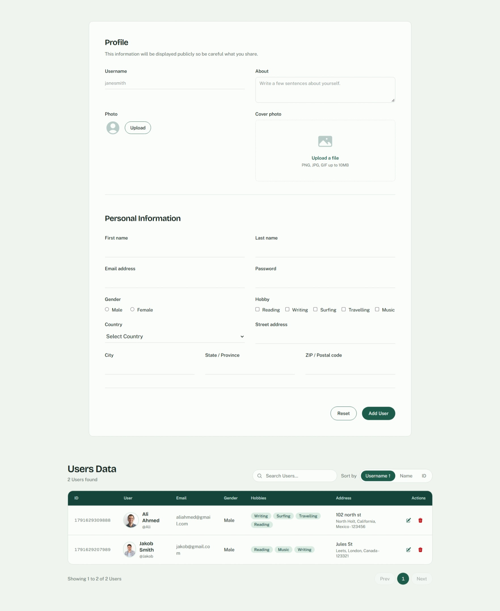

<div align="center">

# Project : User Management System

**A responsive and interactive User Management application built with React (Vite), JavaScript and Tailwind CSS. Users can be added, edited, deleted, searched, sorted and paginated from a single page, with a validated registration form, compressed profile and cover photos, and all data stored in the browser's Local Storage. Styled with a small custom design system of pine, mint and ink colors.**

</div>

---

## 📑 Table of Contents

- [Project Description](#-project-description)
- [How This Project is Made](#-how-this-project-is-made)
- [Features](#-features)
- [Technologies Used](#-technologies-used)
- [React Concepts Covered](#-react-concepts-covered)
- [How It Works](#-how-it-works)
- [Project Structure](#-project-structure)
- [Getting Started](#-getting-started)
- [Screenshot](#-screenshot)
- [Future Improvements](#-future-improvements)
- [Demo](#-demo)

---

## 📌 Project Description

The **User Management System** is a single-page application for registering and managing user records. A detailed form collects a username, an about text, a profile photo and a cover photo, along with personal details such as name, email, password, gender, hobbies, country and full address.

Submitted users are saved in the browser's **Local Storage**, so the records are still there after the page is refreshed. Below the form, a data table lists every user and lets you **search, sort, edit, delete and paginate** the records without leaving the page.

This project was built to practice React from scratch: controlled forms with `useState`, validation, working with arrays using `filter()`, `map()`, `sort()` and `slice()`, reading and writing `localStorage`, handling image files with `FileReader` and the Canvas API, and styling a complete interface with **Tailwind CSS** and a custom set of design tokens.

---

## 🚀 How This Project is Made

This project is built using **React (Vite)**, **JavaScript**, **Tailwind CSS v4** and **Heroicons** to create a clean and responsive **User Management System**.

### 🧱 Component Structure

- `main.jsx` mounts `App.jsx`, and `App.jsx` renders a single `Form` component that holds the whole page.
- `Form.jsx` contains the registration form, the search box, the sort controls, the users table and the pagination.
- A small reusable `TextField` component inside `Form.jsx` renders a label, an input and an error message, so the text inputs are not repeated in the code.
- The form is divided into two sections:
  - **Profile**: Username, About, Profile Photo and Cover Photo.
  - **Personal Information**: First Name, Last Name, Email, Password, Gender, Hobbies, Country, Street Address, City, State and PIN / Postal Code.
- The **Users Data** section shows the title and user count, a search box, a "Sort by" control, the table and the pagination controls.

### 🎨 Tailwind CSS Styling

- Tailwind CSS v4 is added through the official `@tailwindcss/vite` plugin, and `index.css` only needs `@import "tailwindcss";`.
- Design tokens are declared once in an `@theme` block in `index.css`, and Tailwind turns them into classes such as `bg-pine`, `text-ink` and `border-line`. Changing a color there updates the whole page.
- The palette is made of **ink** (main text), **muted** (secondary text), **paper** (page background), **card** (form and table surfaces), **line** (borders), **pine** and **pine-dark** (actions and active states) and **mint** (chips and tints).
- Two fonts are loaded from Google Fonts: **Bricolage Grotesque** for headings and names, and **Public Sans** for everything else.
- The form uses a responsive 6-column grid (`sm:grid-cols-6`): most fields span 3 columns, and city, state and PIN code span 2 each. On mobile everything stacks into one column.
- The table has a deep pine header, larger avatars with a mint ring, hobby chips and a two-line address. Rows get a light hover tint, and the table scrolls horizontally on small screens.
- Buttons are pill-shaped, inputs use rounded or underlined styles, and containers use larger rounded corners, so each kind of element has a consistent shape.
- A visible keyboard focus ring is set for buttons, selects, radios, checkboxes and the photo upload areas.

### ⚙️ React Functionality

- `useState()` manages every form field, the saved users, errors, the edit id, the search text, the sort field and order, and the current page.
- The saved users are loaded with the function form of `useState`, so the list is read from `localStorage` once on the first render without needing `useEffect`.
- Every input is a controlled input, with its value held in state and updated through `onChange`.
- The table data is calculated in three steps: `filter()` for search, `sort()` on a copy of the array, and `slice()` for the current page.
- `Date.now()` generates a unique numeric ID for each new user.
- `window.confirm()` is used before deleting a user, and `alert()` gives feedback after adding, updating or deleting.
- `try / catch` surrounds every Local Storage write, so a full storage shows a message instead of losing the typed data.

---

## ✨ Features

- User registration form with controlled inputs
- Validation with an error message under each field
- Profile photo and cover photo upload with live preview
- Automatic image compression before saving
- Add, edit and delete users
- Data saved in Local Storage and restored on refresh
- Search across username, name, email, gender, country, city and state
- Sort by username, name or ID, ascending or descending
- Pagination with Prev, page numbers and Next (5 users per page)
- Live "N Users found" count and "Showing X to Y of Z Users" summary
- Hobby chips, large avatars and a two-line address in the table
- Helpful empty states for "no users yet" and "no search results"
- Reset button to clear the form
- Responsive layout built with the Tailwind grid
- Keyboard-friendly focus styles and labeled icon buttons

---

## 🔧 Technologies Used

- React (Vite)
- JavaScript (ES6+)
- Tailwind CSS v4
- Heroicons (`@heroicons/react`)
- HTML5
- ESLint
- Local Storage API
- FileReader and Canvas API

---

## 📚 React Concepts Covered

- Functional components
- Reusable components with props (`TextField`)
- `useState()`, including the function form for lazy initial state
- Controlled components
- Event handling (`onChange`, `onSubmit`, `onClick`)
- Form handling and `e.preventDefault()`
- Form validation with an errors object
- Rendering lists with `.map()` and the `key` prop
- Conditional rendering (`&&`, ternary operators)
- Derived data (filter, then sort, then slice)
- Array methods: `map()`, `filter()`, `sort()`, `slice()`, `includes()`, `some()`, `join()`
- Updating state immutably with the spread operator
- Template literals and dynamic class names
- Local Storage with `JSON.stringify()` and `JSON.parse()`
- File handling with `FileReader`
- Image resizing and compression with the Canvas API
- Responsive design with Tailwind utility classes

---

## 🔄 How It Works

### 👤 Add User
1. The user fills in the form and clicks **Add User**.
2. `validate()` checks every field. If anything is wrong, the error messages appear and nothing is saved.
3. A new user object is created with `id: Date.now()`.
4. The user is appended to the `users` array and saved to Local Storage.
5. A success message appears, the form is reset and the table jumps back to page 1.

### ✏️ Edit User
1. Clicking the pencil icon stores the user's ID in `editId` and copies all of their values back into the form.
2. The page scrolls to the top and the button changes to **Update User**.
3. On submit, the matching user is replaced using `map()`, the list is saved and the form is reset.

### 🗑️ Delete User
1. Clicking the trash icon opens a confirmation dialog.
2. If confirmed, the user is removed with `filter()` and the updated list is saved to Local Storage.

### 🔍 Search Users
- The search is case-insensitive and checks username, first name, last name, email, gender, country, city and state.
- The page returns to 1 whenever the search text changes.

For example, searching for `india` finds every user whose country is India.

### ↕️ Sort Users
- The **Sort by** control offers Username, Name and ID.
- Clicking the active option again flips the order between ascending (↑) and descending (↓).
- The sort runs on a copy of the filtered array, so the saved data is never changed.

### 📄 Pagination
- The table shows **5 users per page**.
- The total number of pages is calculated from the filtered and sorted users.
- An `activePage` value keeps the page number valid, so deleting the last row on a page never leaves you on an empty page.

### ✅ Validation Rules

| Field | Rule |
|---|---|
| Username | 3 to 20 characters: letters, numbers and underscore |
| About | 30 to 200 characters |
| First / Last name | Letters and spaces only, at least 2 characters |
| Email | Must match a valid email pattern |
| Password | 8 to 16 characters with an uppercase letter, a lowercase letter, a number and one of `! @ # $ % ^ & * _ . -` |
| Gender | One option must be selected |
| Hobby | At least one hobby must be selected |
| Country | One country must be selected |
| Street address | At least 5 characters |
| City / State | Letters and spaces only |
| PIN code | Exactly 6 digits |
| Photos | Both a profile photo and a cover photo are required |

### 🖼️ Image Upload & Compression
- Only image files are accepted.
- Each photo is read with `FileReader`, drawn onto a `<canvas>` and exported as a compressed JPEG Base64 string.
- The profile photo is resized to a maximum width of **500px** and the cover photo to **800px**, both at 70% quality.
- Compression matters because Local Storage holds only about 5MB.

### 💾 Local Storage

```javascript
localStorage.setItem("Users", JSON.stringify(updatedUsers));
```

When the page loads, the saved list is read back:

```javascript
JSON.parse(localStorage.getItem("Users"));
```

### 🗂️ User Data Structure

```text
User
│
├── id
├── username
├── about
├── firstName
├── lastName
├── email
├── password
├── gender
├── hobby[]
├── country
├── streetAddress
├── city
├── state
├── pinCode
├── photo
└── coverPhoto
```

---

## 📂 Project Structure

```text
user-management/
│
├── public/
│
├── src/
│   ├── components/
│   │   └── Form.jsx
│   │
│   ├── output/
│   │   ├── form.jpeg
│   │   ├── no-data-table.png
│   │   └── data-table.png
│   │
│   ├── App.jsx
│   ├── index.css
│   └── main.jsx
│
├── eslint.config.js
├── index.html
├── package.json
├── vite.config.js
└── README.md
```

---

## 🛠 Getting Started

```bash
# 1. Clone the repository
git clone <your-repo-url>
cd user-management

# 2. Install dependencies
npm install

# 3. Start the development server
npm run dev

# 4. Check the code with ESLint
npm run lint

# 5. Build for production
npm run build
```

Dependencies installed through `npm install`: `react`, `react-dom`, `@heroicons/react`, `tailwindcss` and `@tailwindcss/vite`.

### Starting the project from scratch

```bash
npm create vite@latest user-management
cd user-management
npm install
npm install @heroicons/react tailwindcss @tailwindcss/vite
```

Choose **React** and **JavaScript** when asked, then enable the Tailwind plugin in `vite.config.js`:

```javascript
import { defineConfig } from "vite";
import react from "@vitejs/plugin-react";
import tailwindcss from "@tailwindcss/vite";

export default defineConfig({
  plugins: [react(), tailwindcss()],
});
```

Finally, import Tailwind and declare the color and font tokens in `src/index.css`, and render `<Form />` from `App.jsx`.

### Deploying

Push the project to GitHub and import it on Netlify or Vercel with these settings:

| Setting | Value |
|---|---|
| Build command | `npm run build` |
| Publish directory | `dist` |

---

## 📸 Screenshot

### User Registration Form


---

## 🔮 Future Improvements

- Store passwords securely: hash them on a server instead of saving plain text in Local Storage
- Replace `alert()` and `window.confirm()` with toast messages and a confirmation modal
- Check that usernames and emails are unique before adding a user
- Let the user choose how many rows to show per page
- Export the users table to CSV
- Add a light and dark mode toggle
- Move the data from Local Storage to a real backend and database
- Split `Form.jsx` into smaller components (form, search, table, pagination)
- Add automated tests for the validation rules

---

## 🎬 Demo

| | |
|---|---|
| 🔗 Live Demo | [User Management Website](https://lighthearted-cendol-56ecfa.netlify.app/) |
| 🎥 Project Walkthrough | [Project Explanation](https://drive.google.com/file/d/1FVadYASW19N8aM3aJ78zdVjxt4s42MJe/view?usp=sharing) |

---

<div align="center">

⭐ Thank you for visiting this repository!

</div>